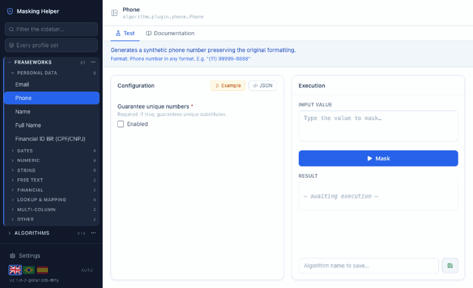

# Delphix Masking Helper

**English** · [Português (BR)](README.pt-BR.md) · [Español](README.es.md)

🌐 **[Website](https://adelbs.github.io/delphix-masking-helper/)** — what it does, and the full framework reference, in three languages.

A local companion for the Delphix masking plugin, covering an algorithm's whole life. It helps you
**understand** how each of the 31 masking frameworks behaves, **test** an algorithm against real
values, **build** a configured algorithm from a problem described in plain language, and **sync**
with Delphix — **Data Control Tower** or a **Continuous Compliance Engine**, one or the other — pulling its algorithms down to work on and pushing yours back up. All
without creating a Rule Set or running a masking job.

It covers sensitive data discovery too: the **data classes** a column can belong to, the
**classifiers** that decide it — each one testable against a column you describe — and the
**discovery policies** a discovery job runs. Ready-made discovery policies for the data protection laws of
**Chile, Mexico, Panama, Belize, Brazil, Colombia, Argentina, El Salvador, Peru, Ecuador, Uruguay, Costa Rica, Spain and Jamaica** ship with the tool, each loaded in one click and documented
in a PDF.

> **Wording follows Delphix, and Data Control Tower.** A **framework** is a masking technique the
> plugin provides — Secure Lookup, Character Mapping, Date Shift. Configuring one produces an
> **algorithm**: named, saved and ready to use. The sidebar lists frameworks; what you save is an
> algorithm. For discovery the names are DCT's: **data class** and **discovery policy** — a
> Continuous Compliance Engine used on its own calls the same objects domain and profile set.

> ### Independent project, and it needs an active Delphix licence
>
> **No affiliation with Delphix.** This is an independent open source project. It is not built,
> endorsed, reviewed or supported by Delphix or its owners, and nothing here is an official
> product. Delphix and the product names used here are trademarks of their respective owners.
>
> **An active Delphix licence is required.** The masking frameworks live in Delphix product jars,
> which are licensed and are **not** distributed here — this project neither ships nor replaces
> them. You must already be entitled to them and able to obtain the Masking Devkit (SDK) from
> Delphix, normally through an active licence and your account team. Drop fifteen jars into
> `lib/` — see [Delphix libraries](#delphix-libraries) below.
> Reference: [Compliance Algorithm SDK](https://portal.perforce.com/s/article/Compliance-Algorithm-SDK-for-Guidewire-1728062704114).



<sub>Four things, in order: running an algorithm against a real value; testing a classifier
against a column described on screen, and seeing which data class discovery would assign; the discovery
policies that ship with the tool; and the integration with a Delphix engine, with an algorithm that
came down from it. Every masked value is real output from the plugin, every score comes from the
local classifier evaluator, and the engine is a real one.</sub>

## How it works

The Node server exposes a REST API that delegates every operation to `AlgorithmRunner.jar`, which loads and runs the algorithms through reflection. The React frontend is served by Vite in development (with hot-reload) and by Express in production.

## Framework guide

📖 **[Browse the framework reference online](https://adelbs.github.io/delphix-masking-helper/frameworks.html)** — the same content as the PDFs, in three languages.

Every framework opens with two tabs: **Test** and **Documentation**. The Documentation tab shows
that framework's section of the reference guide, in the interface language — the same content as
the PDFs below, read from the same source, so the two never disagree.

The classifier screen has the same **Documentation** tab: it opens with how discovery settles
a data class, followed by the section for the classifier framework in hand.

The [`docs/`](docs/) directory holds a reference guide for the plugin's 31 frameworks, in three languages:

| Language | File |
|---|---|
| English | [`docs/delphix-frameworks-guide.en.pdf`](docs/delphix-frameworks-guide.en.pdf) |
| Português (BR) | [`docs/delphix-frameworks-guide.pt-BR.pdf`](docs/delphix-frameworks-guide.pt-BR.pdf) |
| Español | [`docs/delphix-frameworks-guide.es.pdf`](docs/delphix-frameworks-guide.es.pdf) |

For each framework the guide covers what it does, input → output examples, and an explanation of every configuration parameter. Frameworks are grouped by the same categories used in the UI sidebar. Part 10 turns to sensitive data discovery: how a data class is decided, and the `PATH`, `TYPE`, `REGEX` and `LIST` classifier frameworks. There are also three appendices: cross-cutting concepts (determinism, the role of the key, frameworks that may not mask anything), the catalog of the 59 `dlpx-core:` algorithms embedded in the plugin, and the limitations of the standalone runner.

Every input → output pair was generated by actually running the frameworks in `AlgorithmRunner` — none of them are illustrative.

### Regenerating the PDFs

The sources live in `docs/src/` (one HTML per language + a shared `guide.css`). After editing, rebuild:

```bash
./docs/build.sh            # all languages
./docs/build.sh pt-BR es   # only the given languages
```

The build uses headless Chrome and fonts installed on macOS (Iowan Old Style, Seravek, Menlo), so the PDFs should be regenerated on a Mac to preserve the typography.

## Delphix libraries

The tester runs the real frameworks out of the Delphix masking plugin, so it needs a handful of
jars from the Delphix product. **They are not distributed with this repository** — they are
licensed Delphix files. You supply them yourself, once.

1. Request the **Masking Devkit (SDK)** for your Continuous Compliance Engine version from Delphix, through
   your account team or the support portal. Delphix documents the SDK here:
   [Compliance Algorithm SDK](https://portal.perforce.com/s/article/Compliance-Algorithm-SDK-for-Guidewire-1728062704114).
2. Unpack it and copy these fifteen jars from `sdkTools/lib/` into [`lib/`](lib/):

| | |
|---|---|
| `delphix-algorithm-plugin-*.jar` | `masking-extensibility-api-*.jar` |
| `jackson-annotations-*.jar` | `jackson-core-*.jar` |
| `jackson-databind-*.jar` | `jackson-datatype-jdk8-*.jar` |
| `jackson-datatype-jsr310-*.jar` | `jackson-module-jsonSchema-*.jar` |
| `guava-*.jar` | `failureaccess-*.jar` |
| `ant-*.jar` | `commons-codec-*.jar` |
| `commons-compiler-*.jar` | `commons-lang-*.jar` |
| `janino-*.jar` | |

Versions do not need to match anything in particular — the server matches by filename prefix, so
whatever ships in your SDK works. Everything else under `sdkTools/lib/` belongs to the SDK's own
CLI and is not needed; copying it all also works, it just bloats the classpath.

If a jar is missing, the server says so on startup and names what it could not find, and the UI
shows the same message instead of failing silently. To point at a plugin jar outside `lib/`, set
`DLPX_PLUGIN_JAR` to its full path.

See [`lib/README.md`](lib/README.md) for what each jar is for.

## Install

**macOS / Linux**

```bash
curl -fsSL https://adelbs.github.io/delphix-masking-helper/install.sh | bash
```

**Windows** — in PowerShell, not the Command Prompt: `irm` is a PowerShell command, and
`cmd.exe` answers `'irm' is not recognized`.

```powershell
irm https://adelbs.github.io/delphix-masking-helper/install.ps1 | iex
```

If that fails with `Could not create SSL/TLS secure channel`, PowerShell is negotiating TLS 1.0,
which GitHub no longer accepts — older Windows, Server 2016 among them. Run this first, in the
same window, and then the line above:

```powershell
[Net.ServicePointManager]::SecurityProtocol = [Net.SecurityProtocolType]::Tls12
```

Prefer to read it first? That is the same thing in two steps:

```bash
curl -fsSL https://adelbs.github.io/delphix-masking-helper/install.sh -o install.sh
less install.sh && bash install.sh
```

The script asks where to install, checks that Node, Java and git are present — it never installs
them, it only tells you what is missing — clones the newest release, builds it, and puts a `dlpx-helper`
command on your PATH.

| | |
|---|---|
| `dlpx-helper` | start it and open the browser |
| `dlpx-helper stop` | stop it |
| `dlpx-helper status` | is it running? |
| `dlpx-helper version` | which version is installed |
| `dlpx-helper logs` | follow the log |
| `dlpx-helper update` | move to the newest release and rebuild |
| `dlpx-helper uninstall` | remove it (asks first) |

### Which version am I on?

Three places say so, and none of them touches the network:

- the **bottom of the sidebar**, under the language flags;
- **Settings → General → About**, with the commit and the update command;
- `dlpx-helper version` in a terminal, plus the line the server prints on startup.

The number comes from the git tag of the checkout, so it is the release you actually have —
`v1.0.3` on a release, `v1.0.3-5-gabc1234` when the code is ahead of the last tag, and
`-dirty` appended when the working tree has edits. Without git it falls back to the version
declared in `package.json`, which may be behind.

**There is no update check.** The tool tells you what you have, never what exists elsewhere;
`dlpx-helper update` is how you find out, by running it. That keeps the same promise as the
local-model default — nothing leaves your machine unless you ask.

**Installs are pinned to a release, not to the tip of `main`.** The script asks the remote for the
newest `vX.Y.Z` tag and checks that out, so a commit pushed after the last release never reaches
you; pre-release tags such as `v2.0.0-rc1` are skipped too. Set `DLPX_REF` to override it —
`DLPX_REF=v1.0.0` pins an older release, and a branch name follows that branch instead. If the
repository has no release tags at all, the script falls back to the default branch and says so.

Running the script again on a machine that already has it offers **update** or **remove**.
Updating never touches `db/`, where your saved algorithms and settings live. Uninstalling deletes
everything, so it warns first — copy the `db/` folder somewhere else if you want to keep what is
in it.

### Or do it by hand

The script does nothing you cannot do yourself:

```bash
git clone https://github.com/adelbs/delphix-masking-helper.git
cd delphix-masking-helper
npm install && npm install --prefix frontend
npm run build
npm start          # http://localhost:3000
```

Either way, the last step is the same and only you can do it: copy the jars from your Masking
Devkit into `lib/`. The app lists exactly which ones when you open it.

## Requirements

- Node.js 22+ (uses the native `node:sqlite`)
- Java 11+
- The Delphix jars above, in `lib/`

## Getting started

```bash
# Install dependencies (root + frontend)
npm install
npm install --prefix frontend

# Development: Express (port 3000) + Vite (port 5173) in parallel
npm run dev
# Open: http://localhost:5173

# Production: builds the frontend and starts Express
npm start
# Open: http://localhost:3000

# Build the frontend only
npm run build
```

## AI assistant

The home screen has a chat that helps you two ways: explaining how a framework works and which
one fits a situation, and **building a ready-to-use algorithm** from a problem you describe in
plain language. You do not need to know which framework to use — that is what it works out.
Building takes a hosted provider — Claude, Gemini, OpenAI or GitHub Models; a local model only advises
(see [A local model advises](#a-local-model-advises)).

For example:

> I need to mask a numeric field in a CHAR column, left-padded with zeros. The column is 15
> characters, and I need a random number that keeps the same number of leading zeros as the
> original value.

The assistant picks Character Mapping with `preserveLeadingZeros`, configures it, and saves it
under **Algorithms** in the sidebar, ready to run.

Before saving, the server **actually runs the algorithm** with the configuration the model
produced. If the runner rejects it — an invented parameter, an invalid combination — nothing is
saved and the error is shown in the chat. A hallucinated configuration never becomes a saved algorithm.

The assistant knows every one of the 31 frameworks: its system prompt is built from the same
descriptions the UI shows, plus the real JSON Schema of each framework read from the plugin.

### Configuring it

Go to **Settings → AI**, pick a provider and fill in the fields. The status card at the bottom
tells you whether the provider is reachable.

| Provider | Endpoint | Credential | Example model |
|---|---|---|---|
| **Ollama (local)** — default | `http://localhost:11434` | none | `llama3.1` |
| Claude / Anthropic | — (official SDK) | API key from [console.anthropic.com](https://console.anthropic.com) | `claude-opus-5` |
| Google Gemini | `https://generativelanguage.googleapis.com` | API key from Google AI Studio | `gemini-2.5-pro` |
| OpenAI | `https://api.openai.com/v1` | API key from [platform.openai.com](https://platform.openai.com) | `gpt-5.6-sol` |
| GitHub Models (Copilot) | `https://models.github.ai/inference` | GitHub token with the `models:read` scope | `gpt-4o` |

The default is Ollama, which runs entirely on your machine — nothing leaves it. To use it:

```bash
brew install ollama     # or download from ollama.com
ollama serve
ollama pull llama3.1
```

API keys are stored in `db/algorithms.db` and are never sent back to the browser: once saved, the
field shows a mask and you replace the key by typing a new one.

"GitHub Models (Copilot)" is the OpenAI-compatible endpoint that comes with a GitHub account.
GitHub Copilot itself has no public chat API for third-party applications.

### A local model advises

With Ollama the assistant explains the catalog and recommends a framework and the values for its
parameters, but it never saves an algorithm: you pick the framework in the sidebar and fill in
what it suggested. The chat says so in a banner for as long as a local model is selected.

That is a measured decision. Tested on `llama3.2:3b` and `llama3.1:8b`, neither model ever
answered "no framework does this" — not even on the questions where that was the only right
answer. What they produced instead was a configuration that runs and does not solve the problem:
the runner accepts it, and you find out much later. A model that cannot say no is not given the
button that writes to your saved algorithms. For algorithms built and validated for you, configure
a hosted provider.

The framework catalog also takes about 12k tokens of context. That is comfortable for Claude and
Gemini, but tight for small local models — one with an 8k window will truncate the catalog and
pick the wrong framework. Prefer a model with a large context.

## Finding things in the sidebar

Two filters, and they narrow together. The **text box** reaches every section at once — a name is
found without knowing which one it lives in — and results come out flat, so a hit is never hidden
behind a heading you would have to open first. The **discovery policy box** keeps only what one set
reaches, followed outwards the way the sync follows it: its classifiers, the data classes they vote
for, those data classes' algorithms, and the frameworks behind them. Picking a policy turns the whole
sidebar into the working set for one compliance rule.

Each section's `⋯` also chooses how it lays its items out, and the choice is remembered:

| Section | Group by |
|---|---|
| Frameworks | category, or nothing |
| Algorithms | framework category, data class, discovery policy, or nothing |
| Data classes | framework category, discovery policy, or nothing |
| Classifiers | data class, framework of the data class's algorithm, classifier framework, discovery policy, or nothing |

Grouping is a view, not a classification. An item can appear under more than one heading — a
classifier belongs to every discovery policy that runs it — and one that falls under none is listed
under **Other**, which is a real answer rather than an error.

## Syncing with Delphix

**Data Control Tower or an engine — one or the other.** Under *Settings → Delphix* you choose what
to integrate with:

- **Data Control Tower (DCT)** — where Delphix now centralises Continuous Compliance: algorithms,
  data classes, classifiers and discovery policies live in DCT and run on its compliance nodes. The
  tool talks to the `/dct/v3` API and authenticates with an API key.
- **Continuous Compliance Engine** — a single engine, through its own Masking API, with a user and
  password. There the same objects are called domains and profile sets.

Never both at once: what is held here mirrors one instance. The tool uses DCT's names either way.

**One instance, mirrored.** Connecting copies everything down at once — every discovery policy,
classifier, data class and algorithm — and the connection fields then lock. There is nothing useful
about editing a URL under a mirror of the instance that URL no longer names, so changing instance,
or moving from an engine to DCT, means removing the integration and setting the other one up.

Three buttons keep it in step:

- **Refresh from Delphix** brings everything down again, updating what is already here.
- **Send everything to Delphix** pushes the other way, in dependency order — algorithms, then the
  data classes that name them, then the classifiers that vote for those, then the policies that run
  the classifiers. Each object still has its own **Send to Delphix** in its editor.
- **Remove integration** forgets the connection and deletes every row linked to that instance.
  "Linked" includes anything you built here and sent to it, which the dialog says plainly:
  `delphix_origin` is the only record of the connection, and it is set by both directions.
  Files already downloaded stay in the files folder.

The plugin's own algorithms (`dlpx-core:`) are not copied down. This tool holds the same plugin, so a
saved copy of one would be a row that answers to nothing. In DCT, its built-in objects — algorithms,
data classes, classifiers and the ASDD Standard policy — stay out too and are never changed; DCT lists
them without the prefix (`CM Digits`, `CreditCard`), and the tool matches one name to the other.

**What is different with DCT.**

- Only what DCT manages comes and goes. The objects DCT only mirrors from connected engines stay
  out — they belong to the engine, and are integrated through it.
- In DCT every object's identity is an id, and names may repeat. The tool updates your object of that
  name instead of creating another beside it.
- A DCT configuration names another algorithm by its id. The tool translates both ways, and the row
  here keeps names — which is what runs locally.
- A file uploaded to DCT belongs to the algorithm that named it, so each algorithm takes its own.
- DCT offers no download for uploaded files: importing brings lookup files and lists as references
  only, named in the summary of what is missing; the object imports either way.
- DCT takes any character in names and descriptions, and keeps a policy's whole description; an
  engine refuses some characters and cuts that description at 50.
- Sending an object that is already the same there does not rewrite it. DCT answers HTTP 500 to any
  update of a Checkdigit algorithm, so a Checkdigit that changed has to be deleted in DCT and sent
  again — the error message says so.

Point the tool at Delphix under **Settings → Delphix** and press **Test connection**; it answers
before anything is saved. To keep the secret off disk, set `DLPX_DCT_API_KEY` (DCT) or
`DLPX_ENGINE_PASSWORD` (engine) in the environment — it takes precedence and the field is then shown
as read-only.

### Data classes

The sidebar's **Data classes** section holds data classes of sensitive data — a data class is a name
and two algorithm references, the default one and the tokenization one, and that is exactly what
this stores. Create one from *Data classes → ⋯ → New data class*; each one has a **Send to Delphix**
button that creates it there, or updates it when the name already exists.

Sending a data class **sends the algorithms it points at first** — Delphix refuses a data class whose
algorithm it does not know. Algorithms Delphix already owns, such as the `dlpx-core:` built-ins, are
left alone: they are read-only there and already right. If an algorithm cannot be sent, the data
class is not sent either, and the message names the algorithm.

Data classes are grouped by the framework behind the algorithm they point at, using the same
categories as everything else. Two lookups stand between a data class and its category, and either
can fail — the algorithm may be a built-in this machine does not have, and not every algorithm on an
instance is framework-based. Those land under **Other**, which on a stock engine is around a fifth.

### Classifiers

Classifiers are what discovery uses to decide which data class a column or field belongs to. Each
one is built on one of four frameworks — **PATH** (the field's name and its table or file),
**TYPE** (its type and length; *Data type* in DCT), **REGEX** and **LIST** (a sample of its values)
— and votes for one data class. The sidebar's **Classifiers** section lists them by data class;
create one from *Classifiers → ⋯ → New classifier*.

The editor explains every parameter of the chosen framework, and the **Test** panel describes a
field — name, table, SQL type, length, sample values — and shows what discovery would conclude: this
classifier's confidence (which path, type, pattern or list decided it, value by value) and the data
class's, weighed together with the other classifiers saved for it, against the discovery policy's
threshold. It tests what is on screen, so a change can be tried before it is saved. Nothing runs on
Delphix: the tool evaluates classifiers locally, reading the regular expressions as Java does. The
few Java constructs it cannot reproduce exactly are flagged rather than approximated.

**Send to Delphix** creates the classifier there or updates it; renaming is fine, since Delphix
renames classifiers in place. Whatever a classifier relies on travels with it: Delphix refuses a
classifier whose data class it does not have, so the data class goes first when this machine has it
— with its algorithms — and a LIST classifier's value files are uploaded when Delphix does not have
them. Importing works the same way in reverse: a classifier comes down with its data class, that
data class's algorithms, and its value files.

### Discovery policies

A discovery policy is what a discovery job actually runs: the classifiers it should try, and the
**assignment threshold** — the confidence a data class has to reach before the job assigns it. The
sidebar's **Discovery Policies** section lists them with their size and threshold; create one from
*Discovery Policies → ⋯ → New discovery policy*.

The editor picks the members from the classifiers held here, filtered by name or data class. There
is nothing to test in a policy: what decides a data class is the classifiers, and they are
configured and tested in their own editor.

Everything a policy leans on travels with it. Importing one brings the classifiers it names, and
through them their data classes, those data classes' algorithms and the value files. **Send to
Delphix** does the reverse: every member is sent first, and the policy is then created or updated
naming them by the ids Delphix gave back — a policy can only reference classifiers Delphix already
holds.

**Pre-configured discovery policies.** *Settings → Discovery Policies* lists the policies that ship
with the tool, each with its PDF documentation and everything it needs. **Load** asks for a pack:
the **essential pack** is the minimum for the law — identity documents, names, contact, address and
birth date — and the **extended pack** is the whole policy. Either one creates the discovery policy,
its classifiers, data classes, algorithms and files in one go. Loading again never duplicates
anything: the button becomes **Reset**, which puts every item back the way it ships and discards
changes made to it, and picking the other pack there switches, removing what the new pack does not
include. **Unload** removes what the policy brought, except anything something of yours still uses;
what was sent to Delphix stays there. If a name the policy uses already belongs to something that did
not come from it, the tool lists what would be replaced and asks first. The policy is named after the
country, the law and its version (`CL - Ley 21.719 - v3`), and the card shows the version it ships
with **and the day that version was built**, so you can tell how old a policy is without opening it.
The format is described in `presets/README.md`.

The list is grouped by region — North America, Central America, the Caribbean, South America,
Europe — and narrowed by a filter box (country, law, number; accents are ignored), the region chips
and *Loaded here only*.

**Download package.** Each policy also downloads as a `.zip` that loads it into Delphix without this
tool: the documentation in three languages, `import.sh` (Linux and macOS: bash, curl, jq) and
`import.ps1` (Windows PowerShell 5.1, which ships with Windows, or PowerShell 7), and every object
already shaped for the Data Control Tower API and for an engine's Masking API, with the lookup and
list files. The script asks first for the language of its messages, then DCT or engine, the address
and credentials, whether to accept a self-signed certificate, and the pack. Before changing anything
it lists the objects that already exist there under the same names and asks to confirm: those are
deleted before the import, and whatever Delphix refuses to delete — because something else uses it —
is updated instead. Every step goes to `import-<date>.log` next to the script; secrets never do.
Running it again resumes where it stopped.

Fifteen ship today, one per country, all with a threshold of 60. The counts below are the
extended pack; each essential pack has 11 to 13 data classes:

| Discovery policy | Law | Data classes | Classifiers | Algorithms | Documentation |
|---|---|---|---|---|---|
| [Chile](presets/chile-ley-21719/) | Ley 21.719 | 73 | 134 | 97 | [en](presets/chile-ley-21719/doc.en.pdf) · [pt-BR](presets/chile-ley-21719/doc.pt-BR.pdf) · [es](presets/chile-ley-21719/doc.es.pdf) |
| [Mexico](presets/mexico-lfpdppp/) | LFPDPPP (2025) | 83 | 155 | 148 | [en](presets/mexico-lfpdppp/doc.en.pdf) · [pt-BR](presets/mexico-lfpdppp/doc.pt-BR.pdf) · [es](presets/mexico-lfpdppp/doc.es.pdf) |
| [Panama](presets/panama-ley-81/) | Ley 81 de 2019 | 76 | 137 | 138 | [en](presets/panama-ley-81/doc.en.pdf) · [pt-BR](presets/panama-ley-81/doc.pt-BR.pdf) · [es](presets/panama-ley-81/doc.es.pdf) |
| [Belize](presets/belize-dpa-2021/) | Data Protection Act, 2021 | 72 | 126 | 84 | [en](presets/belize-dpa-2021/doc.en.pdf) · [pt-BR](presets/belize-dpa-2021/doc.pt-BR.pdf) · [es](presets/belize-dpa-2021/doc.es.pdf) |
| [Brazil](presets/brazil-lgpd/) | LGPD (Lei 13.709/2018) | 84 | 150 | 156 | [en](presets/brazil-lgpd/doc.en.pdf) · [pt-BR](presets/brazil-lgpd/doc.pt-BR.pdf) · [es](presets/brazil-lgpd/doc.es.pdf) |
| [Colombia](presets/colombia-ley-1581/) | Ley 1581 de 2012 | 82 | 145 | 140 | [en](presets/colombia-ley-1581/doc.en.pdf) · [pt-BR](presets/colombia-ley-1581/doc.pt-BR.pdf) · [es](presets/colombia-ley-1581/doc.es.pdf) |
| [Argentina](presets/argentina-ley-25326/) | Ley 25.326 | 83 | 150 | 116 | [en](presets/argentina-ley-25326/doc.en.pdf) · [pt-BR](presets/argentina-ley-25326/doc.pt-BR.pdf) · [es](presets/argentina-ley-25326/doc.es.pdf) |
| [El Salvador](presets/elsalvador-ley-144/) | Decreto 144 (2024) | 85 | 145 | 105 | [en](presets/elsalvador-ley-144/doc.en.pdf) · [pt-BR](presets/elsalvador-ley-144/doc.pt-BR.pdf) · [es](presets/elsalvador-ley-144/doc.es.pdf) |
| [Peru](presets/peru-ley-29733/) | Ley 29733 | 85 | 146 | 119 | [en](presets/peru-ley-29733/doc.en.pdf) · [pt-BR](presets/peru-ley-29733/doc.pt-BR.pdf) · [es](presets/peru-ley-29733/doc.es.pdf) |
| [Ecuador](presets/ecuador-lopdp/) | LOPDP (2021) | 82 | 143 | 107 | [en](presets/ecuador-lopdp/doc.en.pdf) · [pt-BR](presets/ecuador-lopdp/doc.pt-BR.pdf) · [es](presets/ecuador-lopdp/doc.es.pdf) |
| [Uruguay](presets/uruguay-ley-18331/) | Ley 18.331 | 83 | 143 | 111 | [en](presets/uruguay-ley-18331/doc.en.pdf) · [pt-BR](presets/uruguay-ley-18331/doc.pt-BR.pdf) · [es](presets/uruguay-ley-18331/doc.es.pdf) |
| [Costa Rica](presets/costarica-ley-8968/) | Ley 8968 | 81 | 143 | 168 | [en](presets/costarica-ley-8968/doc.en.pdf) · [pt-BR](presets/costarica-ley-8968/doc.pt-BR.pdf) · [es](presets/costarica-ley-8968/doc.es.pdf) |
| [Spain](presets/spain-lopdgdd/) | GDPR + LOPDGDD | 83 | 149 | 341 | [en](presets/spain-lopdgdd/doc.en.pdf) · [pt-BR](presets/spain-lopdgdd/doc.pt-BR.pdf) · [es](presets/spain-lopdgdd/doc.es.pdf) |
| [Jamaica](presets/jamaica-dpa-2020/) | Data Protection Act, 2020 | 74 | 129 | 83 | [en](presets/jamaica-dpa-2020/doc.en.pdf) · [pt-BR](presets/jamaica-dpa-2020/doc.pt-BR.pdf) · [es](presets/jamaica-dpa-2020/doc.es.pdf) |
| [United Kingdom](presets/uk-gdpr-dpa-2018/) | UK GDPR + DPA 2018 | 73 | 130 | 105 | [en](presets/uk-gdpr-dpa-2018/doc.en.pdf) · [pt-BR](presets/uk-gdpr-dpa-2018/doc.pt-BR.pdf) · [es](presets/uk-gdpr-dpa-2018/doc.es.pdf) |

Detection does not lean on column names alone. Databases pad values — a CHAR column fills them with
spaces, a code kept as text often comes with zeros on the left — and discovery tests them as they
come, so every policy removes the padding before matching and its masking keeps the padding in place:
`0012345678` masks as `00` followed by what `12345678` masks to. Where a column's name says nothing —
`CAMPO1`, `FLD_07`, the short names of packaged systems — the values alone find the data wherever
their format is distinctive: documents with a check digit, e-mail addresses, phone numbers, cards,
places, names.

Each one groups its data classes into direct identifiers, quasi-identifiers and the sensitive data its
law names, and masks national identifiers with a valid check digit wherever the number has one —
Chile's RUT, Mexico's CURP and RFC, a natural person's RUC in Panama, Brazil's CPF, CNPJ (alphanumeric too), PIS, voter card and CNS, Colombia's NIT, Argentina's CUIT, CUIL, CBU and CVU, El Salvador's DUI and NIT, Peru's DNI and RUC, Ecuador's cédula and RUC, Uruguay's cédula de identidad and RUT, and the two check digits of a Costa Rican IBAN — the only number in Costa Rica that has any —, and in Spain the letter of the DNI and the NIE, the Seguridad Social number, the account and IBAN digits, the referencia catastral and the CUPS. The README in each folder explains the design and
its limits; the PDF lists every data class, classifier, algorithm and file, with masked examples.

Where Delphix already has an algorithm for the job, the policies use it instead of shipping
their own: CM Numeric for amounts, Credit Card for card numbers, BloodType SL for blood groups and
Brazil CPF. `presets/verify-all.sh` checks every policy — or the ones you pick — from the command line
and keeps a log; `presets/README.md` explains it, and what a new preset should reuse.

**Importing.** There is no per-object import: connecting the integration brings the whole instance
down, and **Refresh from Delphix** brings it down again. An algorithm built on a framework this
tool cannot run is not copied — you never end up with a saved algorithm that cannot be tested — and
is named in the summary instead. What an object references comes with it: the algorithms a
configuration names, a lookup file, a data class's algorithms, a policy's classifiers.

**Lookup files.** A file uploaded to the engine stays in the engine's file store: an algorithm
carries only a reference to it (`delphix-file://upload/…/NAMES.txt`). Importing downloads the file
into **Files** wherever the engine allows it — a Secure Lookup's lookup file and a LIST classifier's
value files. For other frameworks the engine offers no download: the import dialog names those
files, and the algorithm imports either way — add a copy under **Files**, keeping the engine's file
name, and it runs unchanged.

Any list with the right shape is enough to see the algorithm work. To reproduce what the engine
produces, the file has to match it line for line: an algorithm that picks a substitute by hashing
the input selects by position, so a different list is a different result.

**Exporting.** Each saved algorithm has a **Send to Delphix** button. One that came from the engine
is updated there; one you built here is created. The tool remembers where each algorithm came
from, so exporting twice never leaves a duplicate behind. The algorithms it references go first,
and any file the engine could not open — a path on this machine, or an engine file the engine no
longer holds for a new algorithm — is uploaded from **Files**, with the configuration sent pointing
at it. A file missing from this machine stops the send and is named.

**Round trip.** Testing an imported algorithm with a local file does not change what goes back
to the engine: the reference is stored as the engine wrote it, and the local copy is only resolved
when the algorithm runs here. Adjust any parameter, send it back, and the engine keeps reading its
own file. The one way to break that is to pick another file in the configuration form — that
replaces the reference. The form shows an engine-held file as *name (on the engine)* so it is never
mistaken for an empty field; a path on this machine picked there is uploaded when the algorithm is
sent.

**Naming.** On the engine an algorithm's name is its identity and cannot be changed, so the tool
follows the same rule: names are not editable. To work under a different name, use **Duplicate**
and give the copy its name — the copy is unlinked, so sending it creates a new algorithm.

If the engine's masking plugin is older than the one in `lib/`, some frameworks will not exist
there; exporting such an algorithm fails with a message saying so.

## Hooks

The sidebar's **Hooks** section is for the scripts Delphix runs at points of a dataset's life —
Configure Clone, Pre-/Post-refresh, Pre-/Post-snapshot, Pre-/Post-start… — which Data Control Tower
keeps as **hook templates**. A hook here has a name, a **description** of what it is for, a shell
(bash, sh, expect, PowerShell or delegated PowerShell), the script, and the base names of the
credential variables DCT hands it (`<BASE>_USER`, `<BASE>_PASSWORD`).

- **Ready-made hooks**: *Run a masking job (DCT)* and *Run a job collection (DCT)*, in bash and in
  PowerShell (Windows PowerShell 5.1 compatible). Both start the job through DCT, follow it to the
  end and fail the hook when it fails — on Configure Clone, a VDB is only handed over masked.
- **Run on this machine**: the script on screen runs here — bash or sh on Linux and macOS,
  PowerShell on Windows (or PowerShell 7 where installed) — with test values for its variables, its
  output streamed as it prints, a time limit and a Stop button. Credential values are typed for each
  run and never saved; the tool's own secrets are kept out of the script's environment.
- **What a hook can read**: the environment variables Delphix documents for hooks (Oracle,
  SQL Server, AppData/DB2, credentials), each inserted at the cursor with a click.
- **Download script** saves it as `.sh` or `.ps1` to try on another server.
- **Send to Delphix** creates or updates the hook template in DCT, and *Refresh from Delphix* brings
  DCT's hook templates down. Credentials never travel: add the credential variables on the template
  in DCT. A Continuous Compliance Engine has no hook templates, so this needs the DCT integration.

## Interface language

The UI is available in English, Portuguese (BR) and Spanish. By default it follows your browser
language; to pin one, click a flag at the bottom of the sidebar. It applies immediately. Once you
have pinned a language an **auto** link appears next to the flags, which goes back to following the
browser. The choice is stored server-side, so it applies on every browser that opens the app.

## AlgorithmRunner

`AlgorithmRunner.java` is a short-lived Java process (forked per request) that:

1. Reads JSON from stdin with `command`, `framework`, `config`, `input`, `key`
2. Instantiates the framework class through reflection
3. Applies the configuration via `ComponentConfigurator.applyConfiguration`
4. Builds a minimal `ComponentService` with a `CryptoService` derived from the key
5. Calls `setup()` recursively, then `validate()`, then `mask(input)`
6. Returns the result as JSON on stdout


## Compiling the AlgorithmRunner

If you modify `AlgorithmRunner.java`:

```bash
cd java-runner
javac --release 11 -cp "$(ls ../lib/*.jar | tr '\n' ':')" AlgorithmRunner.java
jar cfe AlgorithmRunner.jar AlgorithmRunner *.class
```

`--release 11` matters: the jar is committed and nothing rebuilds it on the machine that installs
the tool, so this bytecode is what every user runs. Without the flag `javac` targets whatever JDK
you happen to have, and anyone on an older Java hits `UnsupportedClassVersionError` on their first
masking operation. Java 11 is the floor the prerequisites and the installers promise.

## License

[Mozilla Public License 2.0](LICENSE). Modifications to this project's files stay open; you can
combine it with code under other licenses. The Delphix jars it loads at runtime are not covered by
this license and are not distributed here.

**Trademarks and affiliation.** Delphix, Delphix Continuous Compliance and any other product names
referenced here are trademarks of their respective owners. This project is independent: it is not
affiliated with, endorsed by or supported by them, and using it does not grant any right to the
Delphix software it loads.
